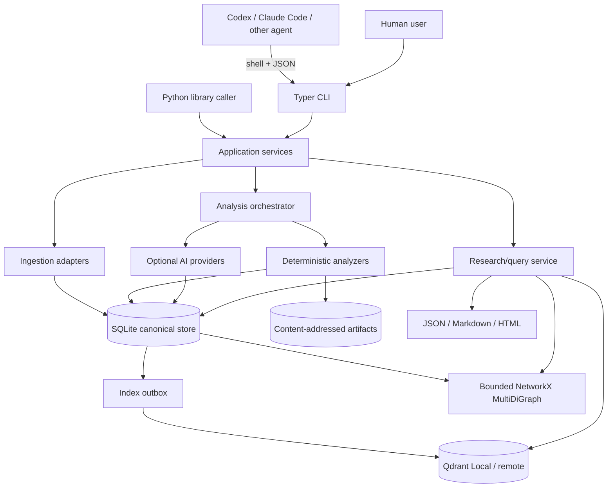

# SocialDNA Architecture

Status: approved; Milestones 0–1 and local enrichment (3) implemented

Date: 2026-11-04

Implementation status: version `0.0.3` adds optional local enrichment to the CLI/storage and video foundation. The user explicitly selected Milestone 3 before Milestone 2; semantic/graph memory remains unimplemented. Analytics, psychological discovery, media breadth, and the skill remain planned.

## 1. Executive decision

SocialDNA will be a local-first Python 3.11+ application with a CLI-first public interface and a portable Agent Skills bundle. The first release will prove one end-to-end path: ingest an authorized local video, build a synchronized evidence timeline, persist deterministic observations, index semantic representations, construct durable graph relationships, and retrieve a grounded report in a later process.

The storage components have deliberately unequal roles:

- **SQLite is the canonical system of record.** It owns domain records, analysis state, provenance, graph rows, canonical vector documents, index outbox entries, and report metadata.
- **Qdrant Local is a rebuildable semantic index.** A missing or stale vector entry reduces search quality but never makes canonical research data disappear.
- **NetworkX is a bounded in-process computation view.** Graph nodes and edges are durable SQLite rows. NetworkX materializes only the relevant subgraph for traversal or algorithms; it is never serialized as the source of truth.
- **The artifact directory is a content-addressed blob store.** Frames, audio, contact sheets, model outputs, and reports are files referenced from SQLite by checksum.

This hierarchy is the main safeguard against cross-store corruption. SQLite transactions atomically commit canonical records plus an outbox operation. Qdrant is updated after commit and can be reconciled or rebuilt. Graph persistence does not require distributed coordination because graph rows live in the same SQLite database.

## 2. Product boundaries

### Guaranteed local capabilities

- Local video, photo, carousel, CSV, JSON, subtitle, and creator-owned export ingestion.
- Deterministic media probing and feature extraction without a paid API key.
- Partial analysis when optional models are absent.
- Persistent SQLite, Qdrant Local, and SQLite-backed graph memory.
- JSON output suitable for agents, plus Markdown and HTML reports.
- Traceable claims with source IDs, timestamps, analyzer/model versions, limitations, and uncertainty.

### Optional capabilities

- Downloaded local transcription, OCR, embedding, gesture/landmark, audio-classification, and vision-language models.
- Explicitly configured hosted model providers.
- Official YouTube, Instagram, and TikTok adapters when the user and use case are eligible.
- External Qdrant and, later, alternative relational or graph stores for larger deployments.

### Non-goals for the first release

- Scraping private content, bypassing authentication, or downloading platform media without a permitted source.
- Claiming causal effects from ordinary observational account data.
- Inferring sensitive traits, diagnoses, or hidden mental states from faces, voices, comments, or content.
- A web application, distributed task queue, always-running daemon, custom MCP server, Neo4j, or PostgreSQL.
- Real-time trend claims unless a dated, permitted trend source was actually queried.

## 3. Corrections to the proposed architecture

The specification has a strong product direction, but several parts need firmer boundaries.

1. **Three stores cannot be updated as one transaction.** Treating SQLite, Qdrant, and NetworkX as equal databases would produce orphaned vectors and graph edges after failures. The canonical-record-plus-outbox design makes vector indexing explicitly eventual and repairable.
2. **Qdrant Local is not a thousand-video production backend.** The current local client holds an exclusive lock on its directory, recommends server mode for concurrent access, and warns when a collection exceeds 20,000 points. A thousand videos can cross that limit quickly if every scene, transcript sentence, and comment is embedded. Local mode therefore has one process-wide client, one mutating CLI process at a time, bounded representations, collection-size warnings, and a documented external-Qdrant migration path.
3. **NetworkX should not load the whole research graph by default.** A SQL neighborhood query first bounds nodes, edge types, depth, and maximum result size; only that induced `MultiDiGraph` is materialized.
4. **Platform ingestion cannot promise arbitrary account research.** Official access varies sharply by platform and ownership. The dependable core is local files and user-provided exports. Platform adapters import only fields the caller is permitted to access and never substitute scraping.
5. **A generic `features` JSON blob would sabotage analytics.** Structural media records and frequently queried numeric observations need normalized columns and indexes. Extensibility belongs in a feature-definition registry plus a typed observation table, not in opaque unindexed JSON alone.
6. **Model-provider independence needs capability contracts, not one universal `generate()` method.** Transcription, embeddings, OCR, vision interpretation, audio interpretation, and text reasoning have different inputs, outputs, timestamps, and privacy risks.
7. **Psychological analysis needs a claim lifecycle.** A taxonomy label from an LLM is a hypothesis, not a measured fact. Observations, hypotheses, associations, and causal findings remain distinct records and report sections.
8. **Incremental execution needs durable work state.** Analysis depth, task fingerprints, leases, retries, partial failure, model versions, and cache reuse must be first-class records.
9. **Semantic search is not enough.** SQLite FTS5 provides local lexical retrieval and remains available when embeddings are missing. Hybrid queries fuse FTS, dense vectors, structured SQL filters, and bounded graph expansion.
10. **The suggested directory tree is too deeply split for an empty project.** Start with cohesive modules and add provider/platform subpackages only when a second implementation exists.

## 4. System context



There is no internal network service in Local Mode. CLI commands construct an application container, open the database and the one Qdrant client, perform or resume work, close resources explicitly, and exit.

## 5. Architectural layers and modules

The initial package should use this shape:

```text
src/socialdna/
├── cli/                 # Typer commands, output envelopes, exit-code mapping
├── application/         # analyze/import/query/report use cases and orchestration
├── core/                # IDs, clocks, errors, hashing, enums, logging
├── config/              # platform paths, settings, provider profiles, consent policy
├── domain/              # Pydantic command/result contracts and domain value objects
├── storage/             # SQLite unit of work, migrations, artifacts, locks, health
├── ingestion/           # local media and tabular imports; platform adapters later
├── media/               # ffprobe/FFmpeg/OpenCV extraction and unified timebase
├── analyzers/           # deterministic and model-assisted analyzers
├── providers/           # capability protocols and optional provider implementations
├── memory/              # Qdrant, FTS, graph projection, outbox reconciliation
├── analytics/           # metrics, baselines, cohorts, statistics, validation
├── psychology/          # taxonomy and evidence-constrained hypothesis generation
├── research/            # hybrid retrieval, candidate discovery, findings, experiments
└── reporting/           # renderers and evidence citation formatting
```

The repository-level `skills/socialdna/` directory packages instructions and references. It invokes the installed CLI; it does not duplicate engine logic.

### Core interfaces

Protocols should be narrow and capability-specific:

```python
class Transcriber(Protocol):
    def transcribe(self, audio: AudioInput, options: TranscriptionOptions) -> TranscriptTrack: ...


class OcrEngine(Protocol):
    def recognize(self, frames: Sequence[FrameInput], options: OcrOptions) -> list[TextSpan]: ...


class Embedder(Protocol):
    @property
    def space(self) -> EmbeddingSpace: ...
    def embed(self, documents: Sequence[EmbeddingDocument]) -> Sequence[Vector]: ...


class VisionInterpreter(Protocol):
    def interpret(self, evidence: VisionEvidenceBundle, schema: type[T]) -> T: ...


class AudioInterpreter(Protocol):
    def interpret(self, evidence: AudioEvidenceBundle, schema: type[T]) -> T: ...


class TextReasoner(Protocol):
    def reason(self, evidence: ResearchEvidenceBundle, schema: type[T]) -> T: ...


class VectorIndex(Protocol):
    def upsert(self, entries: Sequence[VectorEntry]) -> None: ...
    def search(self, query: VectorQuery) -> list[VectorHit]: ...
    def delete(self, entry_ids: Sequence[str]) -> None: ...
```

Every provider advertises capabilities, model identity, revision, dimensionality where relevant, local/remote execution, supported languages/modalities, and resource estimates. A provider response is accepted only after Pydantic validation. Invalid structured output is retried within a configured budget and otherwise recorded as an unavailable analysis component.

## 6. Analysis orchestration and incremental execution

### Task DAG

An `AnalysisPlan` expands a target and depth profile into a dependency graph. A standard video plan is:

1. Probe media and hash the source.
2. Register streams and establish the original presentation timebase.
3. Detect shots/scenes.
4. Select frames using scene boundaries, regular samples, motion peaks, and perceptual deduplication.
5. Extract audio and supplied subtitle tracks.
6. Run deterministic visual and audio analyzers.
7. Run optional transcription and OCR.
8. Assemble the unified timeline.
9. Run optional visual/audio/language interpretation over evidence bundles.
10. Derive post-level features and candidate psychological hypotheses.
11. Persist graph relationships and vector documents.
12. Reconcile the vector outbox.
13. Render a partial or complete report.

### Cache and invalidation

Each task has a stable fingerprint:

```text
SHA256(
  analyzer_name + analyzer_version +
  canonical_config_json +
  ordered_input_artifact_hashes +
  provider_name + model_revision + prompt_schema_version
)
```

Completed tasks with the same fingerprint may be reused. A new transcription model invalidates transcript-dependent language and psychology tasks but not scene detection or color extraction. A new performance snapshot invalidates account baselines and associations but not media extraction. Failed or interrupted runs resume at unfinished/stale tasks.

Task states are `pending`, `running`, `succeeded`, `failed`, `skipped`, `stale`, and `cancelled`. Mutating runs acquire a data-directory writer lock. Task leases make abandoned `running` tasks recoverable after a process crash.

### Depth profiles

Profiles are versioned configuration, not separate pipelines:

- **quick:** ffprobe, sparse scene-aware frames, supplied subtitles, basic color/brightness/contrast, shot lengths, loudness envelope, and a compact report.
- **standard:** adaptive scene sampling, optical flow summaries, transcription when configured, OCR on deduplicated candidates, core audio features, embeddings, and memory updates.
- **deep:** denser samples around cuts/motion/speech hooks, word alignment, optional landmarks/audio classifier/VLM reasoning, interaction features, counterexample retrieval, and strict inference budgets.

The report always lists which planned tasks ran, were cached, were skipped, or failed.

## 7. Unified multimodal timeline

All temporal records use integer milliseconds in half-open intervals `[start_ms, end_ms)` relative to the original media timeline. Container and stream timestamps from `ffprobe` are retained in provenance so variable frame rate and non-zero stream offsets are not lost. Frame ordinals are metadata, not the primary clock.

The timeline does not store a giant merged JSON document. It is a query facade over scenes, frames, text segments/words, audio segments, observations, and evidence items. A request for `0–5000 ms` performs indexed interval queries and returns ordered lanes:

- visual structure and selected frames;
- deterministic visual observations;
- speech, supplied subtitles, and OCR as separate tracks;
- audio observations;
- model interpretations;
- psychological hypotheses;
- evidence-linked performance context.

This preserves original sources and allows a user to compare speech with supplied subtitles or embedded text instead of silently merging them.

### Visual pipeline

- Probe and decode with FFmpeg/ffprobe; use OpenCV arrays for analysis.
- Detect shots using PySceneDetect `AdaptiveDetector` by default, with configurable fallback/content thresholds and recorded version/configuration.
- Select the first/last/middle scene frames, regular samples, and motion peaks; remove near-duplicates using perceptual hashes and histogram distance.
- Compute deterministic HSV/LAB histograms, dominant palette, luminance, saturation, contrast, entropy/edge density, blur proxy, subject/face/landmark geometry when an optional model is installed, and optical-flow summaries.
- Treat face/pose landmarks and visible movements as observations. Labels such as “excited” or “trustworthy” are never deterministic outputs and, if a model suggests them, remain uncertain interpretations.
- Send only evidence bundles (keyframes/contact sheets plus measurements and timestamps) to a vision model. Never send every frame.

### Speech, text, and OCR pipeline

- Prefer supplied SRT/VTT as a distinct authoritative track when present.
- Use `faster-whisper` as the default optional local ASR because it supports CPU/GPU execution, VAD, batching, and word timestamps with a lighter deployment than a full PyTorch alignment stack.
- Offer WhisperX as an optional precision-alignment/diarization adapter, not the default. It adds forced alignment models, larger dependencies, language/model availability constraints, and token/license requirements for some diarization models.
- Use RapidOCR plus ONNX Runtime as the initial optional OCR adapter. Run it on deduplicated frames and track text boxes, confidence, frame time, and temporal persistence.
- Derive speaking rate from timed words, pause statistics from speech gaps/VAD, questions and calls to action from text rules plus optional language reasoning, and hook candidates from the opening interval.

### Audio pipeline

- Use FFmpeg EBU R128 analysis for integrated/short-term loudness when available, rather than equating raw amplitude with loudness.
- Use librosa/SciPy for RMS/energy envelope, spectral centroid/bandwidth/rolloff, zero-crossing rate, onset strength, tempo candidates, silence, and pitch estimates where signal quality permits.
- Separate direct measurements from uncertain classes such as music, sound effect, or delivery style. Music/SFX classification is an optional model capability; “calm”, “dramatic”, or similar labels are interpretations.
- Align every derived window to the same millisecond timebase and record sample rate, window, hop, and algorithm configuration.

## 8. Evidence and claim model

An `EvidenceItem` is the smallest citable unit. It may identify a media interval, frame, transcript span, OCR box, artifact, metric observation, deterministic observation, or source record. Reports cite stable evidence IDs and optionally human-readable locators such as `00:00.840–00:02.300`.

Claims use an explicit ladder:

1. **Observation:** direct/imported or deterministically measured data.
2. **Hypothesis:** an evidence-constrained proposed mechanism or explanation.
3. **Association:** a saved statistical relationship with a population, analysis specification, effect estimate, interval, diagnostics, and counterexamples.
4. **Causal finding:** allowed only when an experiment or defensible causal identification strategy is registered and its assumptions are recorded. Ordinary regression never promotes a claim to this level.

Every hypothesis and finding has supporting evidence, contradictory evidence/counterexamples, alternative explanations, context scope, confidence method, and provenance. Confidence is not a free-form LLM percentage: it is either a calibrated model score with documented calibration or an ordinal rubric derived from evidence completeness, agreement, and statistical precision.

## 9. SQLite design

### Conventions

- SQLAlchemy Core manages connections and transactions; Alembic applies numbered migrations. SQLite-specific FTS and pragmas remain explicit migration SQL.
- Enable `PRAGMA foreign_keys=ON`, `journal_mode=WAL`, a bounded `busy_timeout`, and an application-controlled checkpoint policy. WAL is for same-host filesystems only; `doctor` rejects/warns on unsafe network filesystems.
- IDs are opaque lowercase UUID strings. Deterministic UUIDv5 IDs are used for externally keyed entities and vector points; UUIDv4 IDs are used for generated records.
- Datetimes are RFC 3339 UTC text (`...Z`). Source timezone and original text are preserved separately when relevant.
- Temporal media offsets are integer milliseconds. Content hashes are lowercase SHA-256.
- JSON columns hold variable metadata only and use `CHECK(json_valid(...))`. Frequently filtered or analyzed values have typed columns.
- Unknown values are absent or have an explicit availability state; they are never stored as zero.

### System, execution, and provenance

| Table | Key columns | Purpose and constraints |
|---|---|---|
| `alembic_version` | Alembic revision key | Records the applied migration head. Startup verifies that the installed revision graph is complete and the database is at a supported head. |
| `analysis_runs` | `id PK`, `target_type`, `target_id`, `depth`, `profile_version`, `config_json`, `config_hash`, `status`, timestamps | One requested analysis. Indexed by target and creation time. |
| `analysis_tasks` | `id PK`, `run_id FK`, `task_key`, `fingerprint`, `analyzer`, `analyzer_version`, `status`, `attempt_count`, lease fields, `reused_from_task_id`, `error_json` | Durable DAG state. Unique `(run_id, task_key)` and indexed fingerprint/status. |
| `artifact_objects` | `id PK`, `sha256 UNIQUE`, `kind`, `mime_type`, `relative_path`, `byte_size`, `created_at` | Content-addressed files under the data directory. |
| `source_records` | `id PK`, `source_kind`, `source_uri`, `permission_basis`, `terms_json`, `retrieved_at`, `raw_artifact_id FK`, `content_hash` | What was imported and under which authority. |
| `provenance_records` | `id PK`, `source_record_id FK`, `method`, tool/model identity, `prompt_hash`, `config_json`, `created_at` | Reproducibility for imports, analyzers, and model calls. |
| `provenance_links` | `entity_type`, `entity_id`, `provenance_id FK`, `role` | Many-to-many provenance without putting provider columns on every table. |
| `data_availability` | `subject_type`, `subject_id`, `field_key`, `status`, `reason`, `observed_at`, `provenance_id FK` | Distinguishes not supplied, not permitted, not applicable, failed, and known unavailable. |

### Creators, accounts, posts, media, and audience data

| Table | Key columns | Purpose and constraints |
|---|---|---|
| `creators` | `id PK`, optional display fields | A person/organization identity only when the data supports linking accounts. No inferred sensitive attributes. |
| `accounts` | `id PK`, `creator_id FK NULL`, `platform`, `external_id`, `handle`, `niche`, `profile_json` | Unique `(platform, external_id)`; handle is not assumed stable. |
| `posts` | `id PK`, `account_id FK`, `platform`, `external_id`, `content_type`, `published_at`, `source_timezone`, `title`, `caption`, `url`, `status` | Unique platform/external ID when available; indexed by account/time/type. |
| `media_assets` | `id PK`, `sha256`, `media_type`, original/managed URI, `duration_ms`, dimensions, streams JSON, `artifact_id FK NULL` | Deduplicated physical/logical media. Source files are referenced by default and may be copied into managed storage explicitly. |
| `post_media` | `post_id FK`, `media_asset_id FK`, `position`, `role` | Ordered carousel/media membership. Unique `(post_id, position)`. |
| `tags` | `id PK`, `kind`, `normalized_value`, `display_value` | Hashtags, topics, and imported categorical tags. |
| `post_tags` | `post_id FK`, `tag_id FK`, `source`, `confidence` | Separates supplied tags from inferred topics. |
| `comments` | `id PK`, `post_id FK`, `parent_comment_id FK NULL`, external ID, pseudonymized author ID, `body`, `published_at`, public metrics | Raw comments only when permitted; supports deletion and minimization. |
| `comment_clusters` | `id PK`, `post_id FK NULL`, `label`, `summary`, `method`, `run_id FK` | Topic/reaction clusters; these, not every comment, are embedded by default. |
| `comment_cluster_members` | `cluster_id FK`, `comment_id FK`, `score` | Auditable cluster membership. |

### Timeline, text, features, and evidence

| Table | Key columns | Purpose and constraints |
|---|---|---|
| `scenes` | `id PK`, `media_asset_id FK`, `ordinal`, `start_ms`, `end_ms`, `detector`, `score` | Non-overlapping detected shots/scenes per detector run. |
| `frames` | `id PK`, `media_asset_id FK`, `timestamp_ms`, `ordinal NULL`, `selection_reason`, `perceptual_hash`, `artifact_id FK` | Selected evidence frames, not every decoded frame. |
| `text_tracks` | `id PK`, `media_asset_id FK`, `track_type`, `language`, `source`, `is_primary`, `run_id FK` | Keeps speech, supplied subtitle, platform subtitle, and OCR tracks separate. |
| `text_segments` | `id PK`, `track_id FK`, `start_ms`, `end_ms`, `text`, `confidence`, `speaker_label NULL` | Sentence/cue/OCR persistence segments. Indexed by track and interval. |
| `text_words` | `id PK`, `segment_id FK`, `ordinal`, `start_ms NULL`, `end_ms NULL`, `text`, `confidence NULL` | Word timing only when actually supported. |
| `ocr_boxes` | `id PK`, `text_segment_id FK`, `frame_id FK`, normalized box coordinates, `rotation` | Spatial evidence for embedded text. |
| `audio_segments` | `id PK`, `media_asset_id FK`, `start_ms`, `end_ms`, `segment_type`, `confidence`, `run_id FK` | Speech, silence, music/SFX candidates, and transitions. |
| `feature_definitions` | `key PK`, `modality`, `value_kind`, `unit`, `description`, `aggregation`, `schema_version` | Registry for extensible, comparable observations. |
| `observations` | `id PK`, `subject_type`, `subject_id`, `feature_key FK`, typed value columns, `start_ms NULL`, `end_ms NULL`, `confidence NULL`, `run_id FK`, `provenance_id FK` | Measured/inferred features. A check enforces exactly one value representation. Indexed by feature, subject, interval, and numeric value. |
| `evidence_items` | `id PK`, subject locator, interval/frame/text/artifact/observation/metric references, `excerpt`, `provenance_id FK` | Stable citation target with checks preventing an empty locator. |

### Metrics and statistics

| Table | Key columns | Purpose and constraints |
|---|---|---|
| `metric_definitions` | `key PK`, `subject_type`, `value_kind`, `unit`, `numerator_key`, `denominator_key`, `definition`, `platform_scope` | Prevents treating similarly named platform metrics as identical. |
| `metric_observations` | `id PK`, `subject_type`, `subject_id`, `metric_key FK`, integer/real value, `observed_at`, `window_start`, `window_end`, `post_age_seconds`, `provenance_id FK` | Append-only snapshots; unique on subject/metric/observation/source identity. |
| `derived_metrics` | `id PK`, subject, `metric_key`, value, formula/version, input snapshot IDs JSON, `run_id FK` | Reproducible rates, normalized outcomes, and account baselines. |
| `cohorts` | `id PK`, `name`, `population_spec_json`, `created_by_run_id FK` | Immutable analysis population definition. |
| `cohort_members` | `cohort_id FK`, `subject_type`, `subject_id`, `role`, `match_set_id NULL`, `weight NULL` | Comparison and matched-set membership. |
| `statistical_analyses` | `id PK`, `question_id FK NULL`, `method`, `spec_json`, `outcome_key`, `status`, `run_id FK` | Pre/post specification, covariates, split strategy, missing-data policy, seed. |
| `statistical_results` | `id PK`, `analysis_id FK`, `term`, estimate, standard error, interval, raw/adjusted p-values, sample/cluster counts, diagnostics JSON | Machine-readable effects and uncertainty; not just prose. |

### Psychology, research, experiments, and reports

| Table | Key columns | Purpose and constraints |
|---|---|---|
| `psychological_mechanisms` | `id PK`, `slug UNIQUE`, `version`, `name`, `definition`, observable cues JSON, exclusions JSON | Versioned taxonomy maintained as data/reference content. |
| `hypotheses` | `id PK`, `subject_type`, `subject_id`, `mechanism_id FK`, `statement`, `context`, `confidence_level`, alternatives JSON, `status`, `run_id FK` | Proposed explanation; cannot use causal status. |
| `hypothesis_evidence` | `hypothesis_id FK`, `evidence_id FK`, `role`, `weight NULL` | Roles include supporting, contradictory, counterexample, and alternative. |
| `research_questions` | `id PK`, `question`, `scope_json`, `registered_at`, `status` | Defines the intended population and accessible data before discovery. |
| `findings` | `id PK`, `question_id FK NULL`, `claim_level`, `statement`, `scope_json`, `confidence_level`, `analysis_id FK NULL`, `status`, `supersedes_id FK NULL` | Versioned research memory. Causal level requires a linked qualifying experiment/analysis. |
| `finding_evidence` | `finding_id FK`, `evidence_id FK`, `role` | Supporting examples, counterexamples, limitations, and performance evidence. |
| `experiments` | `id PK`, `finding_id FK NULL`, `name`, `design_json`, hypotheses/outcomes, status, timestamps | A/B or creator test briefs and eventual outcomes. |
| `reports` | `id PK`, `report_type`, target, `run_id FK`, `format`, `artifact_id FK`, `schema_version`, `created_at` | Generated artifacts tied to the exact analysis state. |

### Vector index registry and outbox

| Table | Key columns | Purpose and constraints |
|---|---|---|
| `embedding_spaces` | `id PK`, provider/model/revision, `modality`, `dimension`, `distance`, normalization, prefixes, `collection_family`, `active` | Immutable compatibility boundary. A dimension/model change creates a new space. |
| `vector_documents` | `id PK`, `entity_type`, `entity_id`, `representation_kind`, `content`, `content_hash`, metadata JSON, `active`, `created_by_run_id FK` | Canonical representation that can regenerate vectors. |
| `vector_index_entries` | `document_id FK`, `space_id FK`, `point_id UNIQUE`, `collection_name`, `indexed_hash`, `status`, timestamps, `error` | Cross-store reconciliation state. Unique `(document_id, space_id)`. |
| `vector_outbox` | `id PK`, operation, `document_id FK`, `space_id FK`, `expected_hash`, `status`, lease/attempt fields | Durable upsert/delete work committed with canonical changes. |

### Persistent graph

| Table | Key columns | Purpose and constraints |
|---|---|---|
| `graph_nodes` | `id PK`, `node_type`, `entity_type`, `entity_id`, `label`, attributes JSON, `version`, timestamps | Usually one node per canonical entity; unique `(node_type, entity_type, entity_id)`. |
| `graph_edges` | `id PK`, `source_node_id FK`, `target_node_id FK`, `edge_type`, `directed`, `claim_level`, `confidence_level`, attributes JSON, `valid_from`, `valid_to`, `run_id FK` | Multiple typed edges between a pair require `MultiDiGraph`; causal edge types are guarded. |
| `graph_edge_evidence` | `edge_id FK`, `evidence_id FK`, `role` | Makes every inferred association traversable back to evidence or contradiction. |

### Critical indexes and deletion behavior

- Interval indexes: `(media_asset_id, start_ms, end_ms)` on scenes, frames, text segments, audio segments, and temporal observations.
- Account history: `(account_id, published_at)` on posts.
- Metric history: `(subject_type, subject_id, metric_key, observed_at)`.
- Feature analytics: `(feature_key, numeric_value)` and `(subject_type, subject_id, feature_key)`.
- Graph adjacency: `(source_node_id, edge_type)` and `(target_node_id, edge_type)`.
- Outbox leasing: `(status, lease_expires_at)`.
- FTS5 external-content indexes cover post title/caption, text segments, comment-cluster summaries, hypotheses, and findings. Rebuild/verify commands check triggers and row counts.

Deleting an account/post/media target is an explicit service operation. It creates vector deletion outbox entries, deletes or tombstones dependent canonical rows according to retention policy, removes managed artifacts only when unreferenced, and verifies graph/vector references. Direct ad hoc deletion is unsupported.

## 10. Qdrant collection design

Physical collection names are derived from a logical family and immutable embedding-space hash:

```text
sdna_content_text__<space8>
sdna_transcript_text__<space8>
sdna_audience_text__<space8>
sdna_research_text__<space8>
sdna_visual_image__<space8>   # optional image embedding space
```

Logical contents:

- `content_text`: whole-post descriptions, titles/captions, hook representations, scene descriptions, and carousel narrative summaries.
- `transcript_text`: bounded transcript chunks with overlap and precise time ranges.
- `audience_text`: comment-cluster/topic summaries, not individual comments by default.
- `research_text`: hypotheses, findings, counterexamples, and experiment briefs.
- `visual_image`: selected frames/thumbnails only when an image embedder is installed.

Every point ID is deterministic UUIDv5 of `(space_id, vector_document_id)`. Common payload fields are `document_id`, `entity_type`, `entity_id`, `account_id`, `post_id`, `media_asset_id`, `platform`, `niche`, `representation_kind`, `language`, `start_ms`, `end_ms`, `content_hash`, and `created_at`. Large text and source evidence remain in SQLite; Qdrant payloads stay compact.

One collection never mixes incompatible dimensions, distance metrics, normalization, or embedding semantics. Model upgrades create a new embedding space and physical collection, populate it incrementally, switch the active registry entry, and retain/delete the old collection by explicit policy.

### Local embedding default

FastEmbed/ONNX is the recommended local text implementation. The proposed default is `intfloat/multilingual-e5-small`, pinned to an exact reviewed model revision: it is MIT-licensed, produces 384-dimensional vectors, supports multilingual retrieval, and is small enough for CPU-first local use. The adapter must apply the model's required `query:` and `passage:` prefixes and explicitly chunk inputs beyond its 512-token limit. Model downloads are explicit (`models prepare` or `--allow-download`), checksum-verified, cached in the SocialDNA model directory, and never silently replaced.

When embeddings are unavailable, vector outbox entries remain pending/blocked with a clear reason. SQLite, FTS, graph, deterministic analysis, and reporting continue. Tests may inject a deterministic test embedder, but the production runtime never labels a hash/test vector as a semantic embedding.

### Query plan

Hybrid retrieval is planned, not a single Qdrant call:

1. Parse the question into structured filters, semantic intents, requested claim level, and comparison outcome.
2. Use SQL for highly selective platform/account/date/duration/metric/feature constraints.
3. Use FTS5 for exact phrases, hashtags, and lexical candidates.
4. Fan out dense searches to the relevant logical Qdrant families, with payload filters where practical.
5. Fuse ranked candidates using reciprocal-rank fusion; keep component scores visible.
6. Hydrate canonical records from SQLite and discard stale/tombstoned hits.
7. Expand a bounded evidence-bearing graph neighborhood.
8. Run statistical comparison only after defining the eligible population and outcome window.
9. Render observations, hypotheses, associations, counterexamples, and limitations separately.

## 11. Persistent NetworkX graph design

`graph_nodes` and `graph_edges` are the persistence API. NetworkX receives a `MultiDiGraph` because the same pair can have several relationships with different evidence, analysis versions, and claim levels.

Graph node types are kept coarse: `Creator`, `Account`, `Post`, `Media`, `Scene`, `Hook`, `Technique`, `PsychologicalMechanism`, `Pattern`, `AudienceReaction`, `PerformanceOutcome`, `Finding`, and `Experiment`. Fine-grained measurements stay observations rather than becoming millions of nodes.

Initial edge types include `OWNS`, `PUBLISHED`, `CONTAINS`, `HAS_HOOK`, `USES_TECHNIQUE`, `OBSERVED_IN`, `APPEARS_WITH`, `PROPOSED_MECHANISM`, `ASSOCIATED_WITH`, `SUPPORTED_BY`, `CONTRADICTED_BY`, and `TESTED_IN`. Edge definitions specify permitted source/target types and maximum claim level. `ASSOCIATED_WITH` can never be rewritten as causal merely because confidence is high.

Graph queries first issue recursive CTE/adjacency SQL with `start_ids`, permitted node/edge types, `max_depth` (default 2), `as_of`, and `max_nodes` (default 2,000). The returned rows are materialized into NetworkX for neighborhood statistics, paths, component analysis, or centrality. Expensive all-graph algorithms require an explicit command and safety limit.

## 12. Statistical discovery and scientific discipline

### Unit of analysis

The default unit for performance discovery is a post, not a frame, scene, or second. Timeline features aggregate into declared post-level variables (for example, opening-3-second motion median or first-hook word rate). Treating every frame as independent would create severe pseudo-replication.

### Comparable outcomes

- Compare metric snapshots at common post ages or within declared observation windows.
- Store denominators and platform-specific definitions for all rates.
- Use creator-relative robust baselines (median/MAD or quantile) and comparable content cohorts before cross-creator claims.
- Preserve missingness; never impute unknown engagement as zero.
- Use log transforms or count/rate models appropriate to distributions and report raw-scale summaries too.

### Discovery workflow

1. Register the research question, population, outcome window, candidate features, and known confounders.
2. Generate candidate relationships from domain rules, graph co-occurrence, and optional LLM reasoning.
3. Deduplicate correlated/redundant feature families before testing.
4. Produce descriptive effect sizes and cluster-aware uncertainty first.
5. Use simple adjusted models: creator/platform fixed effects, GEE or mixed models where justified, robust/clustered standard errors, and explicit interaction terms.
6. Apply false-discovery-rate correction to exploratory families and retain all tested hypotheses, not just positive ones.
7. Validate predictive claims using chronological splits and creator/group separation; preprocessing is fit on training data only.
8. Retrieve nearest comparable successes and failures, plus high-leverage outliers.
9. Run sensitivity checks for cohort definition, influential points, missingness, and feature collinearity.
10. Save the full analysis specification, result table, diagnostics, counterexamples, and limitations.

Small samples remain descriptive. The engine uses method-specific preconditions and emits `insufficient_data` instead of fitting unstable high-dimensional models. Matched comparisons remain associations unless treatment assignment and causal assumptions justify more.

## 13. Psychological pattern engine

The taxonomy is versioned reference data with mechanism definitions, observable cues, exclusion rules, confounders, and examples. The engine operates in three passes:

1. **Cue extraction:** deterministic and model-assisted observations identify literal questions, information gaps, delayed reveals, transformations, social-proof phrases, utility promises, participation prompts, and related evidence.
2. **Hypothesis generation:** a text/vision reasoner receives only bounded evidence and taxonomy definitions and returns structured candidate mechanisms, alternative explanations, applicability, and counterevidence requests.
3. **Adjudication:** rules verify referenced evidence exists, prohibit sensitive/mental-state inference, lower confidence for missing modalities or conflicts, retrieve counterexamples, and require performance analysis before any association claim.

Evaluation uses a small human-annotated gold set with inter-rater labels, precision/recall by mechanism, evidence-span accuracy, and calibration of the confidence rubric. Prompt/model changes version the analyzer and re-run only dependent tasks.

## 14. CLI and agent-skill contract

### CLI shape

Use command groups rather than many hyphenated top-level commands:

```text
socialdna init
socialdna doctor [--format json]
socialdna storage status|verify|reconcile|reindex
socialdna models status|prepare
socialdna import local|csv|json|youtube|instagram|tiktok
socialdna analyze video|photo|carousel|account
socialdna compare posts|accounts
socialdna timeline show
socialdna query
socialdna research discover|show|save
socialdna graph neighbors|path
socialdna report generate
```

Platform commands appear in help only when implemented or are clearly marked unavailable with the enabling extra/configuration. No stub returns invented content.

Global options include `--data-dir`, `--format text|json`, `--offline`, `--no-ai`, `--allow-download`, `--remote-media-consent`, `--log-level`, and resource budgets. Commands accept stable IDs and return them for follow-up operations.

Machine output uses one versioned envelope:

```json
{
  "schema_version": "1.0",
  "command": "analyze.video",
  "status": "partial",
  "run_id": "...",
  "data": {},
  "evidence": [],
  "warnings": [],
  "limitations": [],
  "errors": [],
  "next_actions": []
}
```

Human progress goes to stderr so stdout remains valid JSON. Exit codes distinguish invalid input, unavailable dependency/model, permission denial, partial analysis, storage conflict, provider failure, and internal error.

### Agent Skill

The portable `skills/socialdna/SKILL.md` follows the Agent Skills standard: a concise routing description, a short workflow, and one-level references. Detailed taxonomy, research methodology, CLI schemas, and interpretation rules live under `references/`.

The first release uses the shell CLI as its tool boundary because both Codex and Claude Code can execute it and consume JSON. A custom MCP server is deferred until stable commands and schemas exist; exposing both immediately would double the public API surface.

The skill instructs agents to:

- confirm accessible data and permission before import;
- run `doctor --format json` when environment capability is unknown;
- request JSON output and retain `run_id`/evidence IDs;
- choose quick/standard/deep according to the question and budget;
- never enable model downloads or remote media uploads implicitly;
- separate engine observations, hypotheses, associations, and experiments in the answer;
- disclose partial analysis and missing metrics;
- invoke `research discover` only after enough comparable posts exist;
- cite SocialDNA evidence IDs/timestamps rather than paraphrasing unsupported claims.

Project installation targets `.agents/skills/socialdna/` for Codex-compatible Agent Skills and `.claude/skills/socialdna/` for Claude Code. The repository keeps one canonical skill bundle and packaging/install scripts copy it; divergent agent-specific instruction forks are avoided.

## 15. Consistency, concurrency, recovery, and deletion

### Local concurrency model

- One mutating SocialDNA process per data directory, enforced by a top-level file lock with owner/PID metadata and a timeout.
- SQLite WAL allows same-host readers while the writer is active, but SQLite still has one writer and WAL is not used over a network filesystem.
- One Qdrant Local client instance per process/data directory, opened lazily and explicitly closed. Because local Qdrant locks the directory exclusively, concurrent commands that need it fail fast with an actionable message.
- Read-only commands that require Qdrant share the same application-level lock in Local Mode. External Qdrant removes this restriction.

### Cross-store state machine

1. Commit canonical entity/vector document and pending outbox row in SQLite.
2. Generate/load the embedding outside the SQLite write transaction.
3. Upsert the deterministic point ID to Qdrant.
4. In a new SQLite transaction, mark the index entry current and outbox row complete.
5. If the process dies at any point, retry is idempotent. `storage reconcile` compares document hashes, index registry state, point existence, and tombstones.

Graph node/edge writes are part of the same SQLite unit of work as their claims/evidence. NetworkX has no write-back persistence API; graph mutations always go through graph repositories.

### Backup and integrity

`storage verify` runs SQLite integrity/foreign-key checks, artifact checksum sampling, FTS consistency, graph orphan checks, vector registry reconciliation, and collection schema checks. Backups use SQLite's online backup API after quiescing mutations, copy Qdrant/artifact/model manifests consistently, and include a format/version manifest. Restore validates before becoming active.

## 16. Security, privacy, and permissions

- Treat media, subtitles, comments, CSV, JSON, and model responses as untrusted input. Bound file sizes/durations, use subprocess argument arrays, impose timeouts, and never interpolate paths into shell strings.
- Keep API tokens in environment variables or OS keyring/provider configuration, never SQLite or reports.
- Remote provider profiles declare what leaves the machine. Uploading local media, frames, audio, transcript, or comments requires explicit configuration and per-run consent policy.
- Minimize stored audience identifiers, support pseudonymization, and provide scoped deletion/export.
- Preserve platform/source permission basis and retention constraints with each import.
- Sanitize HTML reports and escape all imported/model text.
- The skill is privileged instructions plus executable access; installation documentation tells users to review it before enabling.

## 17. Scaling and resource limits

### Expected bottlenecks

| Area | Bottleneck | Local mitigation | Scale-out path |
|---|---|---|---|
| Video decode | CPU, disk, long/high-resolution media | One decode plan, downscaled analysis frames, cache artifacts | Worker pool/object storage |
| Optical flow/OCR | Per-frame CPU/GPU | Scene-aware sampling and deduplication | Batched GPU workers |
| ASR/alignment | RAM/VRAM and model download | Model-size/device profiles, VAD, reuse audio | Dedicated inference workers |
| VLM reasoning | token/cost/privacy | Contact sheets, evidence bundles, budgets, opt-in | Batch hosted/local inference service |
| SQLite | single writer | short transactions, one mutating process, WAL | PostgreSQL implementation |
| Qdrant Local | exclusive lock, brute-force search, 20k-point warning | bounded documents, cluster comments, warn near threshold | External Qdrant |
| NetworkX | Python memory and algorithmic cost | bounded SQL subgraphs, graph limits | Neo4j/other graph backend if justified |
| Platform APIs | eligibility, OAuth, quotas, stale/limited metrics | imports, caching, provenance, backoff | approved bulk/reporting APIs |

`doctor` reports CPU features, RAM, optional GPU, free disk, FFmpeg/ffprobe versions, model cache sizes, Qdrant point counts, and recommended depth limits. Resource estimates are displayed before deep runs.

## 18. Major technical decisions and tradeoffs

| Decision | Chosen approach | Tradeoff |
|---|---|---|
| Relational access | SQLAlchemy Core + Alembic, no ORM domain model | Two dependencies, but robust migrations/transactions and a future relational backend seam. |
| Media tools | FFmpeg/ffprobe subprocesses + OpenCV arrays | Requires system FFmpeg; avoids weak Python-only codec coverage. |
| Scene detection | PySceneDetect adaptive detector with versioned config | Thresholds vary by genre; store scores/config and allow overrides. |
| ASR | faster-whisper default optional adapter; WhisperX precision extra | Default word times may be less accurate; much simpler CPU/local install. |
| OCR | RapidOCR/ONNX optional adapter | Model/language packages add size; avoids a separate Tesseract system install. |
| Local embeddings | FastEmbed/ONNX, pinned multilingual model | One-time model download and license/model governance required. |
| Lexical search | SQLite FTS5 | SQLite build must include FTS5; `doctor` verifies it. |
| Vectors | Qdrant Local as derived index | Single-process/small-data ceiling; clean remote-Qdrant seam. |
| Graph | SQLite rows + bounded NetworkX `MultiDiGraph` | Some queries require SQL+Python; avoids a mandatory graph server. |
| Work execution | In-process durable DAG, no Celery | One machine initially; easier installation, testing, and recovery. |
| Agent integration | CLI JSON + portable skill | Less discoverable than MCP tools; one stable public contract instead of two. |
| Reports | Jinja-based static HTML, Markdown, JSON | No interactive dashboard initially; portable and auditable artifacts. |

## 19. External data-access constraints

- **YouTube:** public metadata is available through the Data API subject to quotas; owner analytics requires OAuth authorization for the channel/content owner. The APIs do not make unauthorized media downloading a general ingestion capability. SocialDNA therefore accepts local/owned media or separately permitted media references.
- **Instagram:** official API access targets professional accounts and requires the relevant login, permissions, access level, and account authorization. Consumer-account or arbitrary-account analytics cannot be promised.
- **TikTok:** the Research API is limited to approved, eligible non-commercial/public-interest researchers in supported regions; its archived counts can lag. Commercial creators need other approved products or their own exports.
- Metrics change definitions and availability over time. Every adapter pins API version, stores raw responses when terms allow, maps source metric definitions explicitly, and records retrieval time.

## 20. Approved implementation defaults

The user approved these defaults on 2026-11-04:

1. Accept SQLAlchemy Core + Alembic as the migration/data-access foundation instead of standard-library `sqlite3` plus custom migrations.
2. Accept faster-whisper as the standard local transcription extra and WhisperX as an optional precision extra.
3. Accept CLI JSON as the initial agent tool boundary, deferring MCP until after the CLI schema stabilizes.

Implementation follows `PLAN.md`. Any change to stable IDs, timeline units, claim levels, canonical-store ownership, or CLI output envelope requires an explicit architecture update because persisted data and agent callers depend on those contracts.

## 21. Research basis

Primary sources used for these decisions:

- [Qdrant Python client local mode](https://github.com/qdrant/qdrant-client/blob/master/README.md) and its [local implementation limits/locking](https://github.com/qdrant/qdrant-client/blob/master/qdrant_client/local/qdrant_local.py)
- [SQLite write-ahead logging and concurrency](https://www.sqlite.org/wal.html)
- [NetworkX documentation](https://networkx.org/documentation/stable/) and [induced subgraph behavior](https://networkx.org/documentation/stable/reference/generated/networkx.classes.function.induced_subgraph.html)
- [FFprobe documentation](https://www.ffmpeg.org/ffprobe.html)
- [PySceneDetect documentation](https://www.scenedetect.com/docs/latest/)
- [faster-whisper documentation](https://github.com/SYSTRAN/faster-whisper/blob/master/README.md)
- [WhisperX paper](https://arxiv.org/abs/2303.00747) and [implementation documentation](https://github.com/m-bain/whisperX)
- [FastEmbed documentation](https://github.com/qdrant/fastembed/blob/main/README.md)
- [`intfloat/multilingual-e5-small` model card](https://huggingface.co/intfloat/multilingual-e5-small)
- [RapidOCR documentation](https://github.com/RapidAI/RapidOCR/blob/main/README.md)
- [scikit-learn data-leakage guidance](https://scikit-learn.org/stable/common_pitfalls), [time-aware validation](https://scikit-learn.org/stable/modules/cross_validation.html), and [correlated-feature caveats](https://scikit-learn.org/stable/auto_examples/inspection/plot_permutation_importance_multicollinear.html)
- [statsmodels mixed models](https://www.statsmodels.org/stable/mixed_linear.html), [GEE](https://www.statsmodels.org/stable/gee.html), and [multiple-testing correction](https://www.statsmodels.org/stable/generated/statsmodels.stats.multitest.multipletests.html)
- [SciPy bootstrap confidence intervals](https://docs.scipy.org/doc/scipy/reference/generated/scipy.stats.bootstrap.html)
- [YouTube Data API quotas](https://developers.google.com/youtube/data/getting-started), [video resources](https://developers.google.com/youtube/data/reference/rest/v3/videos/list), and [YouTube Analytics authorization](https://developers.google.com/youtube/analytics/reference)
- [Meta's official Instagram API collection](https://www.postman.com/meta/instagram/documentation/6yqw8pt/instagram-api)
- [TikTok Research API eligibility](https://developers.tiktok.com/products/research-api/) and [Research API limits/data lag](https://developers.tiktok.com/docs/en/research-api-faq)
- [Agent Skills specification](https://agentskills.io/specification), [OpenAI Skills documentation](https://developers.openai.com/api/docs/guides/tools-skills), and [Claude Code Skills documentation](https://code.claude.com/docs/en/skills)

## 22. Milestone 0 implementation decisions (2026-11-04)

The approved store ownership and CLI boundaries are unchanged. The implementation makes the following details explicit:

- **Transactional SQLite DDL:** the SQLAlchemy connection hook disables sqlite3 legacy implicit transactions and an engine begin hook issues `BEGIN`. Alembic receives the existing connection and uses transactional DDL. An injected failure after `CREATE TABLE` is tested to roll back both schema and revision state. This is necessary on Python 3.11, where legacy driver behavior otherwise leaves DDL outside the intended transaction. See [SQLAlchemy's SQLite transaction guidance](https://docs.sqlalchemy.org/en/20/dialects/sqlite.html).
- **Migration checksum ledger:** `migration_checksums(revision, sha256, applied_at)` supplements `alembic_version`. It is committed in the same transaction and detects edits to already-applied migration files. Unknown revision heads and unversioned non-empty databases are rejected without deleting their contents.
- **Frozen schema slice:** the baseline revision owns a frozen `foundation_metadata()` definition. Current Core tables are composed from that slice in `storage/schema.py`. This avoids a historical migration importing mutable future metadata. Subsequent revisions must preserve released revision files and evolve the current schema separately.
- **Explicit artifact references:** `artifact_references(artifact_id, owner_type, owner_id, role)` supports deduplicated owner links. Reference counts also include direct `source_records.raw_artifact_id` and `media_assets.artifact_id` foreign keys. File creation precedes canonical commit, so a rolled-back commit can leave an orphan object; verification reports it and retains it for inspection.
- **Direct lock dependency:** `portalocker` is declared directly instead of relying on Qdrant's transitive dependency. All current CLI operations acquire this lock because they perform first-use initialization and open embedded Qdrant. Lock metadata is modified only after acquisition; crash recovery relies on OS lock release.
- **Typer compatibility:** the implementation requires Typer `>=0.27.2,<0.28` and uses its public `TyperException` interface. Current Typer vendors Click and no longer depends on the standalone Click package, so importing Click for parser error handling is incompatible. See [Typer's vendored-Click guidance](https://typer.tiangolo.com/tutorial/click/) and [release notes](https://typer.tiangolo.com/release-notes/).
- **Schema rollout remains incremental:** only foundation tables are created in Milestone 0. FTS5 is checked with a temporary virtual table; semantic collections and persistent graph rows are not created early. Status/verification output marks these capabilities deferred and does not claim retrieval or graph persistence works yet.
- **Health versus unavailable features:** missing FFmpeg/ffprobe produces warnings and exit 0 for foundation-only commands; future media commands will use the reserved dependency-unavailable exit code 3. Integrity errors return 8, conflicting processes return 6, and malformed inputs/configuration return 2, all through the versioned JSON envelope.
- **Distribution verification:** both the wheel and source archive are installed into fresh temporary environments and invoked from outside the checkout. The verifier can use registry access for dependency resolution or `--offline` with a complete resolver cache. Application runtime checks never download models or contact hosted providers.

No public command was added for media analysis, semantic search, graph traversal, or research. Those implementations remain in Milestones 1–6.

## 23. Milestone 1 implementation decisions (2026-11-04)

Canonical-store ownership, CLI envelopes, IDs and half-open millisecond intervals are unchanged. The implementation makes these choices explicit:

- **Source timing is authoritative:** FFprobe reads per-frame presentation timestamps. A lossless, downscaled FFV1 proxy retains frame order; OpenCV processes arrays while source timestamps align results. Missing/non-monotonic timestamps or proxy frame-count mismatches fail rather than fabricate alignment. Video end comes from the final frame's packet duration with a nominal-rate fallback, while unmodified container/stream metadata remains in `media_probes`. Audio uses its stream offset and actual decoded sample length. This avoids deriving VFR timing from nominal FPS.
- **Bounded reusable visual decoding:** the proxy's longest side is 320 pixels. Scene, motion and evidence selection share it through separate inexpensive proxy passes. FFprobe timestamp discovery, proxy creation, audio extraction and integrated-loudness measurement are separate source passes; a single-pass native decoder was not introduced. This trades temporary disk and FFV1 storage for predictable memory and simpler timestamp correctness. FFmpeg 4.4 compatibility uses `-vsync 0`; no shell interpolation is used. POSIX cancellation terminates the process group; Windows terminates the direct media process.
- **Minimal schema evolution:** revision `0002_timeline` adds media locations/probes, task results/dependencies, scenes, frames, text/audio tracks/segments, feature definitions, observations, evidence and reports. The released baseline revision/checksum remains unchanged. Feature keys/definitions are canonical, observation values are typed numeric/JSON, and task/provenance/evidence rows use foreign keys. Vector documents/outbox and graph rows remain Milestone 2 work.
- **Atomic durable tasks, immutable producers:** each task commits provenance, canonical rows, artifacts/references and a compact result together. Fingerprints include media identity, analyzer version, relevant options/tool/library versions and dependencies. New-run cache hits reference `reused_from_task_id` rather than duplicating canonical outputs. Directly owned artifact checksums are validated before reuse; failed dependencies block consumers. Successful producer rows are immutable. Resume checks the original run configuration/environment before updating its state; changed options/tools require a new run. A data-directory lock, not a distributed lease-reaper, authorizes crash recovery.
- **Partial reports versus execution state:** the existing run/task status constraint is retained. Any failed task makes execution `failed`; the analysis/report contract says `partial` and returns exit 5 while preserving independent successful modalities. An interrupted/running run also generates a partial report, never a success claim. Missing audio/subtitles and future transcription/OCR/multimodal tasks are explicit skips, not invented observations. FFmpeg absence fails before run creation with exit 3; health/storage commands still warn without requiring media tools.
- **Honest feature semantics:** analysis audio is converted to mono 16 kHz PCM without gain normalization. Original-mix integrated input LUFS uses FFmpeg's EBU R128 loudness filter; undefined values remain absent. pYIN pitch, short-window tempo candidates, low-energy windows and optical flow are signal estimates with explicit limitations, not speech/emotion/camera-intent classifications. Framing is aspect geometry only; subject/composition models are deferred. All deterministic measurements carry timestamped evidence and configuration provenance.
- **Reports are managed artifacts:** typed JSON and escaped Markdown snapshots are stored in the existing content-addressed store and indexed by `(run_id, format)`. JSON includes canonical lanes/evidence, feature units/definitions, configuration, provenance and artifact locations. Markdown cites frames, subtitles and measurements and links the contact sheet. No Jinja dependency is added for these simple formats; templated HTML remains Milestone 6. Distinct runs legitimately create distinct report artifacts even when extraction is fully cached; superseded snapshots are retained, not destructively cleaned up.
- **Lean module boundaries:** local import lives in `application/import_service.py`, task orchestration in `application/task_runner.py`, with concrete analyzers/media modules below them. SQLAlchemy Core operations remain in these services instead of adding an empty ingestion protocol, a repository per table, or a separate JSON renderer solely to match the target file map. Adapter abstractions will be introduced when the next working use case needs them.
- **Explicit operating limits:** default input bounds are 2 GB, 600 seconds and 36,000 decoded frames; evidence selection defaults to 120 frames, subtitles to 5 MB, and subprocesses to 300 seconds. These are configurable safeguards, not a codec sandbox. Limits on stdout/stderr prevent unbounded pipe buffering; protocols are restricted to local files/pipes. Python feature computation can still be CPU-heavy, particularly first-time librosa/Numba compilation. Corrupt artifacts are reported rather than overwritten; SIGKILL can leave temporary cache files and orphan objects for inspection.
- **Verification scope:** generated owned fixtures cover cuts, motion, tones, subtitles, VFR, shifted timestamps, short/delayed audio, malformed/oversized inputs, shell-metacharacter names, partial failure, cache invalidation, recovery after each major task and cross-process CLI reports. Distribution smoke tests now exercise installed media analysis and report reopening, not only initialization. CI installs FFmpeg for Linux/macOS/Windows; this workspace directly verifies Linux Python 3.11 with FFmpeg 4.4.2 only.

See `docs/video-analysis.md` for current commands, recovery behavior and interpretation limits. No Milestone 2 indexing or graph implementation is included.

## 24. Milestone 3 implementation decisions (2026-11-04)

The user explicitly requested local model enrichment before persistent research memory. Milestone 3 therefore consumes Milestone 1's canonical timeline/task/evidence interfaces directly. This is an execution-order change, not a new storage architecture: no alternate graph, vector memory, retrieval API, or Milestone 2 placeholder is introduced. Milestone 2 can later index ASR/OCR/model outputs already persisted in SQLite without rerunning inference.

- **Optional, pinned model installation:** `models status|prepare` works in the base install; speech, OCR, alignment, landmarks and audio-classifier runtimes are extras. The initial catalog supplies revision/SHA-256-pinned tiny multilingual faster-whisper, English PP-OCRv4 ONNX, MediaPipe pose-lite and YAMNet bundles. Installation manifests include language, license notes, size bounds and approximate RAM needs; imported custom bundles require reviewed file hashes. Model-weight rights are not inferred from runtime licenses (pose-weight terms are explicitly flagged for review). `models prepare` is the download/import boundary. Inference never downloads, regardless of download permission. Manifest aliases and hash-addressed model directories are installation metadata; scientific identities/input provenance remain canonical SQLite records.
- **Native-runtime isolation:** the durable DAG remains in-process, but optional native inference runs in bounded child processes, with structured request/response files in private temporary directories. This provides cancellation/timeouts and contains optional import/ABI conflicts without adding a job server. The standalone worker can run under an explicitly selected interpreter, including per-capability overrides. This is important because MediaPipe's full/contrib OpenCV and WhisperX's large Torch stack must not replace the engine's headless OpenCV build. CPU inference is the verified default; device-support metadata does not assert GPU availability. Python socket connections/model-hub downloads are disabled in workers, with temporary matplotlib/Numba caches. Native packages/models remain trusted dependencies, not an OS security sandbox.
- **Capability-specific contracts:** transcription/alignment use validated language/segment/nullable-word results; OCR uses normalized per-frame quadrilaterals; pose uses 33 model-estimated landmarks per detected pose; audio classification uses typed timestamped candidate windows; text/vision reasoning uses a bounded evidence/hypothesis schema. The registry checks model capability, implemented backend identity, checksums, and relevant runtime package versions. There is no arbitrary user-code loader or one untyped universal generation API.
- **Same canonical timeline:** `0003_enrichment` adds word timing, frame-linked OCR boxes, inference-input evidence links and provider-call audits. Revision numbering follows deployment order, not milestone numbering; released revisions `0001`/`0002` are unchanged. Supplied subtitles, ASR, aligned ASR and OCR are separate tracks. Word timestamps are nullable and never evenly interpolated from text. OCR matching links adjacent samples with explicit sampling uncertainty. Pose/audio observations are model estimates/candidates, not identities, emotional diagnoses or verified sound labels. A deterministic ASR/subtitle token-agreement measurement is not labeled accuracy/WER without a gold reference.
- **Atomic evidence/provenance gate:** a configured model cannot commit canonical outputs without provider identity and non-empty, registered source-evidence IDs belonging to the analyzed media. Task completion commits provider/model/revision/prompt/config provenance, input links and canonical outputs together. Failed model validation commits no observations. Transcription identity/settings/runtime changes invalidate alignment/comparison/reasoning/timeline dependencies while preserving unrelated decode, scene, visual, audio extraction and OCR cache entries. Interrupted committed model tasks are reusable under the existing lock/resume contract.
- **Opt-in compatible reasoning:** an explicitly configured chat-completions server can accept bounded text and selected JPEG evidence. A local server requires a literal loopback address; remote profiles require HTTPS, an enabled profile, allowed data types and explicit consent. Offline mode blocks remote transfers. Global/leaf CLI consent flags are tri-state so an explicit denial overrides environment/TOML permission. No original video/audio, redirect, proxy-environment routing, implicit discovery or remote fallback is used. Credentials are read from named environment variables and exist only in request headers. API model/revision fields are operator attestations, not a server-weight verification mechanism.
- **Audit before external side effects:** every compatible-provider attempt first commits an exact content-addressed JSON request and an `attempted` call row. Accepted responses are persisted separately after schema/evidence validation; failures retain the request audit. This intentional pre-call transaction differs from atomic canonical model-output commit and records what may have left the process even after cancellation. An interrupted attempt can be retried and billed twice: exactly-once provider execution/billing is not promised. Audit artifacts contain sensitive derived evidence, so they need the same local protection as source data; authorization headers are never persisted.
- **Bounded interpretation, not causal analysis:** text token estimates use conservative UTF-8 byte bounds; selected frame count, request/response byte sizes, output-token requests, attempts and timeouts are bounded. Image tokenization/provider billing cannot be verified by a generic compatible adapter. Responses must cite only supplied evidence and supply alternative explanations. All accepted interpretations are labeled hypotheses with ordinal uncalibrated confidence. Invalid schemas/citations exhaust a small retry budget and produce a partial report. No psychological taxonomy, performance association, diarization or sensitive-attribute classifier is implemented here.
- **Depth and failure semantics:** standard/deep use prepared ASR/OCR automatically, quick requires explicit selection, and deep enables word timing plus pre-run resource estimates. Alignment, pose, audio candidates and reasoning require explicit flags; `--no-ai` disables all of them. Optional auto-selected missing models are skipped; explicitly requested unavailable capabilities and actual model failures make analysis/report partial while leaving deterministic results usable. No-audio capabilities are not applicable, not invented failures. Alignment requires ASR and a matching prepared language model; it cannot overwrite the original transcript or download a missing NLTK/alignment dependency.
- **Verified versus contract-only integrations:** real offline CPU ASR/OCR tests use generated libflite speech/Pillow text and verify cache reuse and process-restart persistence. Real MediaPipe pose/audio smoke tests run through an isolated interpreter and verified official bundles; the synthetic pose fixture does not assess positive human-landmark accuracy. WhisperX's pinned offline API/timing behavior and compatible-server schema/consent/audit behavior have contract tests, but this workspace did not install/run the large alignment checkpoint or evaluate a real VLM/LLM. GPU, macOS and Windows native optional-runtime behavior is not claimed verified. A manual GitHub Actions workflow explicitly prepares pinned ASR/OCR assets for opt-in native testing; core CI requires no models or hosted credentials.

Current configuration, safety boundaries, commands and interpretation limitations are documented in `docs/local-enrichment.md`. The project remains pre-release (`0.0.3`) because the planned memory/release gates have not been met; implementing enrichment out of order does not claim v0.2/v1 readiness.
